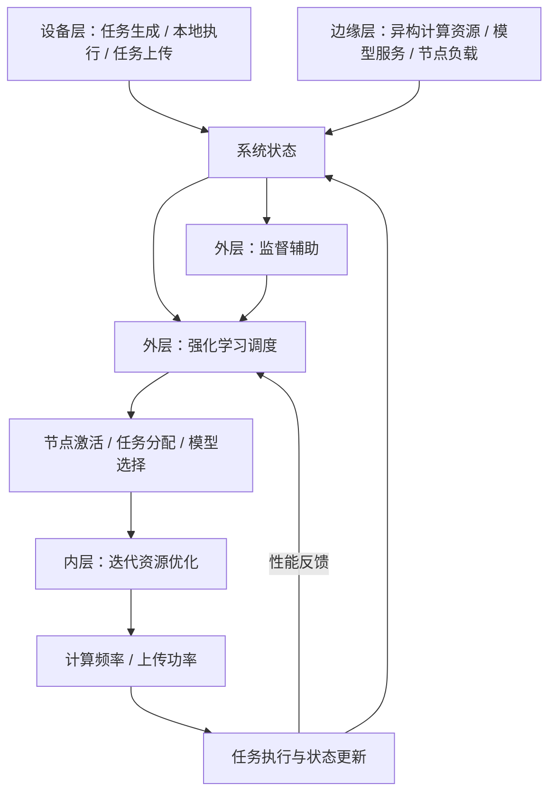

# Edge–Device Scheduling Optimizer

面向协同推理的边缘—设备端调度优化器，集成任务管理、强化学习调度、监督辅助和迭代资源优化，覆盖从任务到达到资源分配、执行反馈与策略更新的完整流程。

## 系统架构

设备端产生具有输入大小、计算需求、截止时间和模型要求的推理任务。调度器根据设备与边缘节点的计算能力、通信状态和队列负载，决定任务执行位置、边缘节点激活及模型选择，并在资源约束下分配计算频率与上传功率。



## 核心功能

- **设备—边缘协同调度**：支持设备本地执行和边缘卸载，协调异构节点与模型兼容约束。
- **动态任务管理**：维护跨时隙任务队列，处理上传、计算、截止时间和队列溢出。
- **外层决策**：强化学习与监督辅助协同决定调度动作，支持策略训练和模型加载。
- **内层优化**：在固定调度下迭代分配通信与计算资源，满足节点算力和设备发射功率预算。
- **实验与评估**：支持多策略、配对场景与多测试种子，记录任务完成、时延、能耗、资源利用率和收敛状态。

## 模型与参数来源

模型规模参数参考 **Qwen3 系列**，默认采用以下两档配置：

| 模型等级 | 参考模型 | 名义参数规模 |
| --- | --- | --- |
| 设备端轻量模型 | [Qwen3-0.6B](https://huggingface.co/Qwen/Qwen3-0.6B) | 0.6B |
| 边缘端模型 | [Qwen3-1.7B](https://huggingface.co/Qwen/Qwen3-1.7B) | 1.7B |

`model_parameters_b` 配置模型规模，调度环境按参数规模比换算相对计算需求。节点算力、信道、任务到达和能耗系数独立配置；这些参数不代表 Qwen3 在特定硬件上的实测性能。系统通过工作负载模型进行调度优化，无需下载 Qwen3 权重。

模型资料：[Qwen3 官方仓库](https://github.com/QwenLM/Qwen3)。配置口径见 [环境与资源模型](docs/environment.md)。

## 安装与运行

运行环境：Python 3.9+，CPU。

```bash
python -m venv .venv
```

激活环境：Windows PowerShell 使用 `.venv\Scripts\Activate.ps1`，Linux/macOS 使用 `source .venv/bin/activate`。

```bash
python -m pip install -r requirements.txt
python run_demo.py --config configs/default.json
```

一键入口依次完成监督样本生成、策略训练和独立场景评估。也可分别执行：

```bash
python train.py --config configs/default.json --episodes 60 --output outputs/run
python evaluate.py --run outputs/run --episodes 5
```

评估需要训练生成的 `policy.npz`、`guide.npz` 和运行配置。训练规模、随机种子与输出目录可通过命令行设置。

```bash
python run_demo.py --config configs/pressure.json --output outputs/pressure
python run_demo.py --no-supervision --output outputs/rl_only
```

## 配置与输出

`configs/default.json` 定义节点资源、模型规模、任务分布、通信预算及优化参数；`configs/pressure.json` 定义高负载场景。

运行目录保存实际配置、训练记录、策略模型、评估汇总、逐时隙指标及逐任务状态。完成率以全部到达任务为分母，时延统计已完成任务，期末剩余任务单独记录。评估口径见 [实验说明](docs/experiments.md)。

## 项目结构

```text
configs/                 场景与资源配置
scheduling/
  scenario.py            工作负载与外生状态
  environment.py         任务管理和环境推进
  outer.py               强化学习与监督辅助
  inner.py               迭代资源分配
  config.py              配置校验
  experiment.py          训练与评估流程
  cli.py                 参数及模型加载
train.py                 策略训练
evaluate.py              策略评估
run_demo.py              完整运行入口
plot_results.py          运行结果绘图
tests/                   环境与优化流程测试
docs/                    环境、实验及模块接口
```

```bash
python -m unittest discover -s tests -v
```

系统采用时隙化通信与计算模型，任务分配后保持执行位置，上传与计算按阶段推进。环境语义与资源约束见 [环境说明](docs/environment.md)，模块接入见 [接口文档](docs/extending.md)。
